# Festive Islands

Floating paper islands in a ring, one festival each, in the order they come round the year. Walk the stepping stones, step through a torana, and become the hero of the story behind the festival: Prahlad for Holi, Ganesha for Ganesh Chaturthi, Durga for Durga Puja, Rama for Dussehra and Diwali, young Krishna for Govardhan Puja.

Built at Festive Hacks 2026 (WeMakeDevs × WeAreDevelopers, Bengaluru). Everything is drawn in one hand-inked, paper-and-ink look.

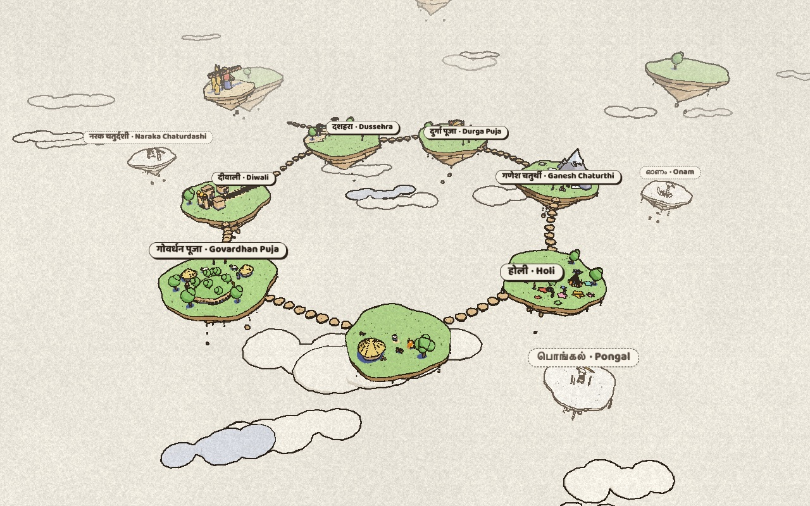

## The islands

### Home · Dadi's aangan

Dadi sits on her charpai and tells you each island is a story. Then she opens her photo album: each festival has a few pages of the family's own photos, and from there she sends you to that island. Every island is open, and the stones glow toward the one she suggests.

| | |
|---|---|
|  |  |

### होली · Holi: Prahlad and Holika

You are the boy Prahlad. Pray to Vishnu in front of your father's throne, then sit calm in Holika's fire while the shawl flies off her. The night of Holika Dahan, walk once round the fire with new wheat; the next morning, throw gulal with the whole village.

| | | |
|---|---|---|
| 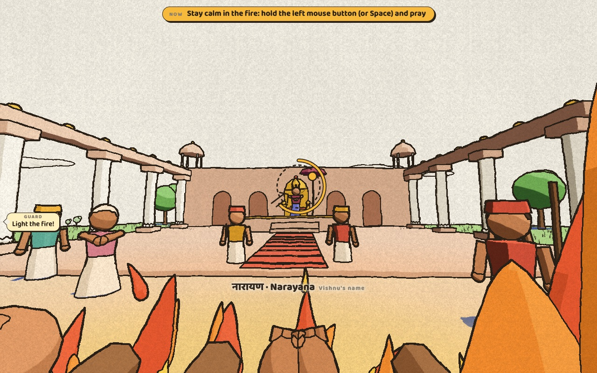 | 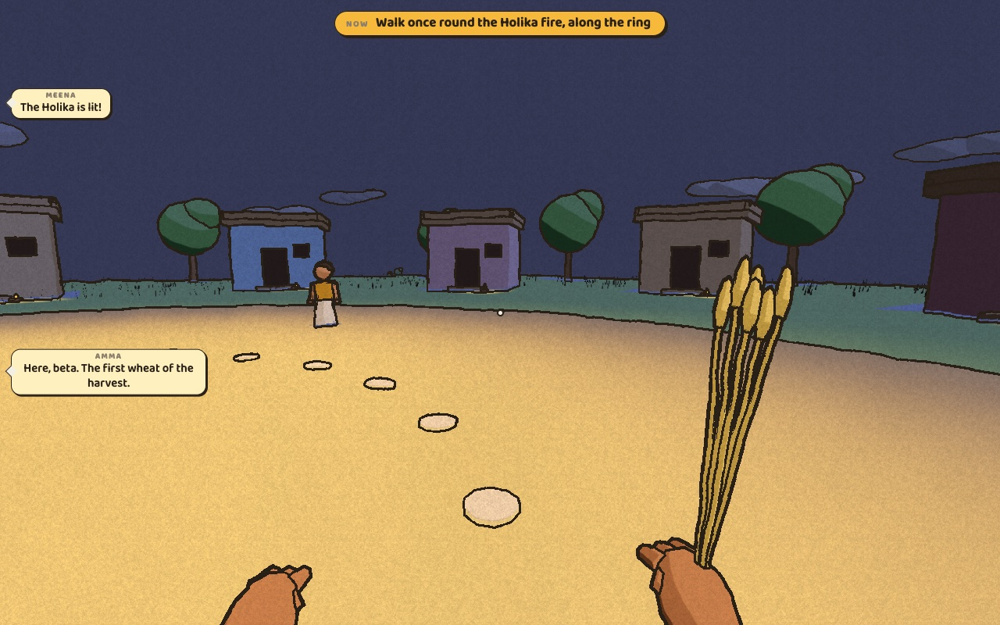 | 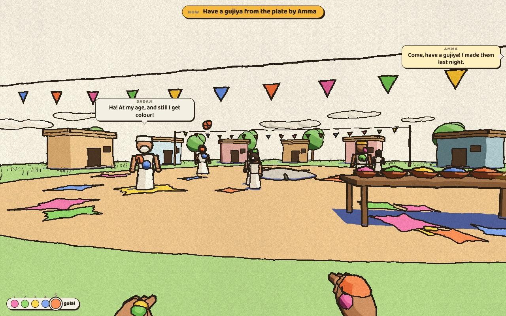 |

### गणेश चतुर्थी · Ganesh Chaturthi: the race round the world

You are Ganesha, with a trunk, a modak and Mushak at your side. Kartikeya flies off on his peacock; you work out that your parents are your world and walk three rounds round them. Then shape your own clay Ganesha, fold modaks with Aaji and join the aarti.

| | | |
|---|---|---|
|  | 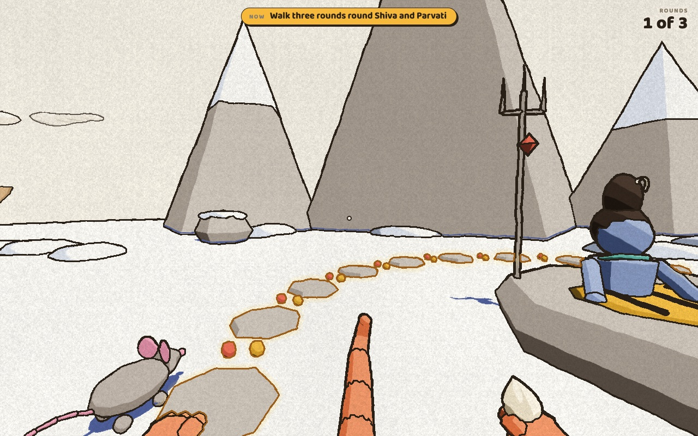 | 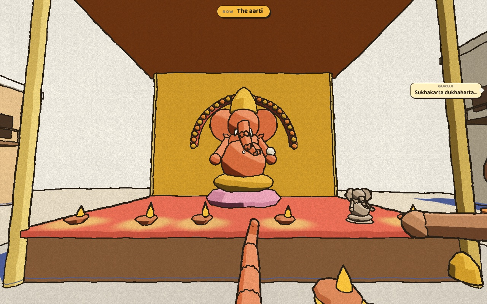 |

### दुर्गा पूजा · Durga Puja: Durga and Mahishasura

You are Durga, with ten arms. Gather the gods' light, take their ten gifts, ride the lion and steady the trishul as Mahishasura changes shape. Then a Kolkata para at night: the dhak, the dhunuchi dance and pushpanjali.

| | | |
|---|---|---|
|  |  | 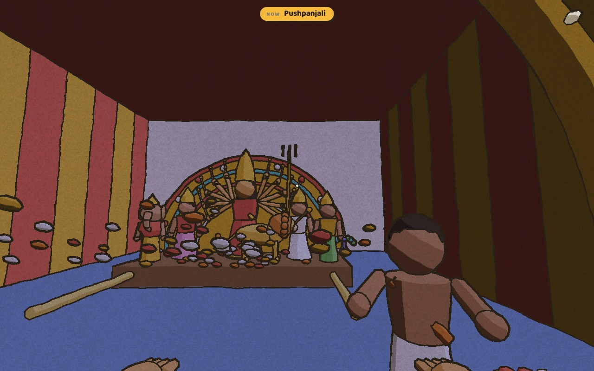 |

### दशहरा · Dussehra: Rama and Ravana

Build the setu stone by stone, cross to Lanka, draw the bow against the wind, then ride into the modern Ramlila and watch the effigies burn.

| | | |
|---|---|---|
| 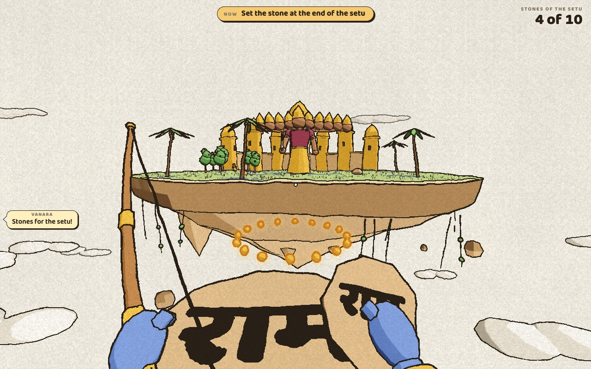 |  |  |

### दीवाली · Diwali: Rama comes home

Land on Amavasya, wear the padukas Bharata kept, and walk home while Ayodhya lights about 770 lamps around you. Fill the rangoli, do the puja.

| | | |
|---|---|---|
|  | 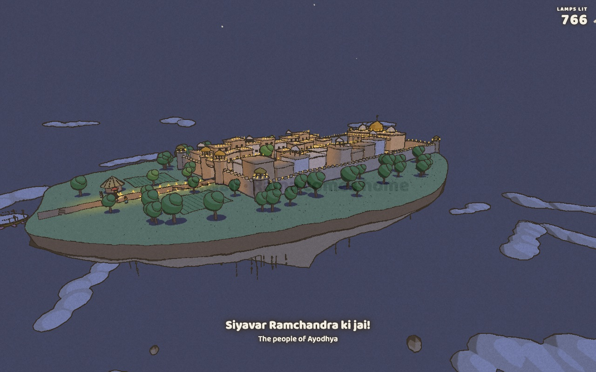 |  |

### गोवर्धन पूजा · Govardhan Puja: the hill that became an umbrella

You are young Krishna. Persuade Vraj, lift Govardhan on your little finger and hold it steady through seven days of rain, then play the flute to bring everyone under it.

| | | |
|---|---|---|
| 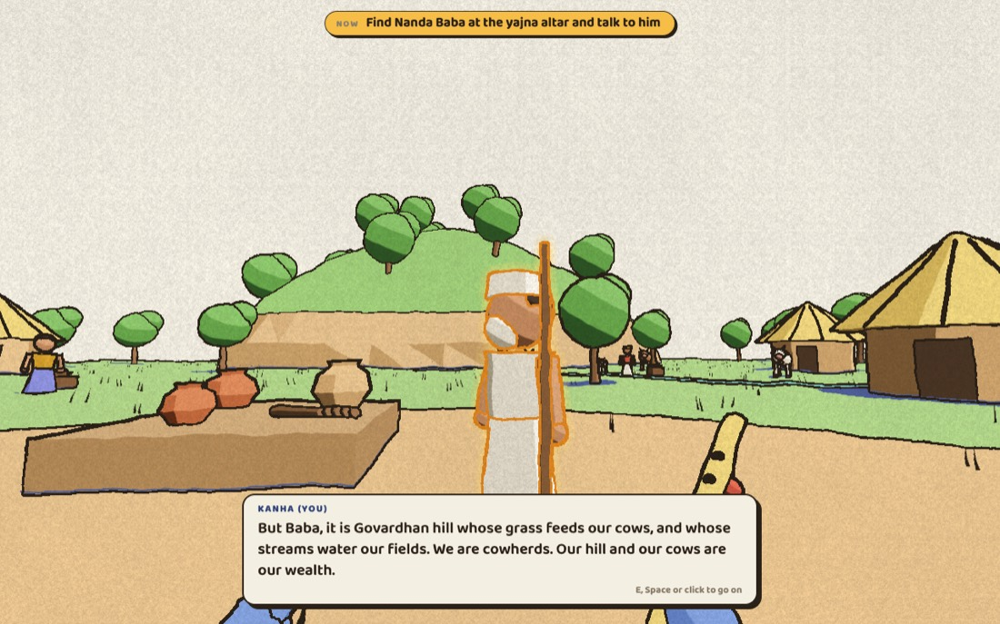 |  |  |

### Colorfigures prototype

The same Govardhan story as an isometric step-through. This is where the design language comes from.

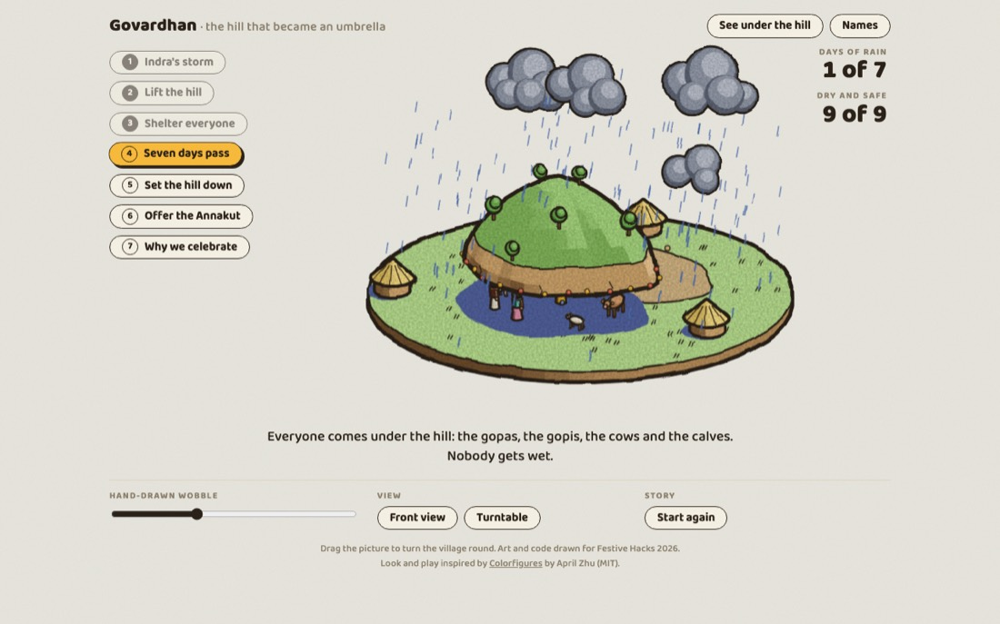

## Layout

```
index.html          the hub: home courtyard, six islands on a ring, gates
courtyard-flags.js  Flagsmith switches for the home courtyard
album/              Dadi's photo album (see album/README.md to add photos)
holi-prahlad/       Holi, first person
ganesh-race/        Ganesh Chaturthi, first person
durga-mahishasura/  Durga Puja, first person
dussehra-rama/      Dussehra, first person
diwali-ayodhya/     Diwali, first person
govardhan-fpv/      Govardhan Puja, first person (the engine the others copy)
colorfigures/       isometric SVG prototype
audio/              dialogue, narration manifests, playback
scripts/            narration generator (Sarvam)
tests/              audio tests
DESIGN.md           the visual language
hub-NOTES.md        hub mechanics, hash states, self-test
```

Each island folder has its own `NOTES.md` (mechanics, how it was built, facts to check) and `shots/`.

## Play

No build step. Three.js and Baloo 2 load from a CDN, so you need a network connection. Keep the folder structure intact, since the islands share the audio scripts and the album.

```bash
open -a "Google Chrome" index.html
```

Any island also opens on its own, for example:

```bash
open -a "Google Chrome" holi-prahlad/index.html
```

### Controls

| Key | Does |
|---|---|
| WASD or arrows | Walk |
| Mouse | Look (click to capture, or drag) |
| Space | Jump (holds instead when a Hold prompt shows) |
| Shift | Sprint |
| E | Talk, take, enter a gate |
| Hold mouse or Space | Draw the bow, lift the hill, stay calm, shape clay, steady the trishul |
| F or right-click | Flute (Govardhan), pray and pichkari (Holi) |
| Click, 1 to 5 | Throw gulal, change colour (Holi) |
| R | Replay the current voiced line |
| Esc or P | Pause: volume, narration language, wobble, progress |

## Audio and narration

Begin plays a short Apple Music cue in the hub, Dussehra, Diwali, and Govardhan. The pause menu saves Voice, Music, and Effects levels across islands. Holi, Ganesh Chaturthi, and Durga Puja share the voice and effects controls. Narration language switches voiced dialogue and subtitles between English and हिन्दी.

Dialogue is authored in `audio/dialogue.js` and `audio/dialogue-hindi.js`. The main conversations in all six islands and Dadi's welcome have recorded voices. Voices and transition cues are configured in `scripts/generate-narration.ts`. If a clip is missing, the player still sees the authored text.

Generating narration needs Node 22.15+, FFmpeg on PATH and `SARVAM_API_KEY` in your environment. To regenerate specific lines, append their cue IDs after the language, for example `en-IN dadiIntro-5`.

```bash
node --experimental-strip-types scripts/generate-narration.ts en-IN
```

```bash
node --experimental-strip-types scripts/generate-narration.ts hi-IN
```

## Test

Audio tests:

```bash
node --experimental-strip-types --test tests/*.test.ts
```

Gameplay self-test: open the hub or any first-person island in Chrome and add `#selftest` to the end of the URL in the address bar. It plays the whole thing through and prints PASS or FAIL on the page and in the console.

Hash states like `#overview`, `#album=holi-prahlad`, `#fire` or `#dahan` jump straight to a beat. Each `NOTES.md` lists them.

## Credits

- The look is inspired by [Colorfigures](https://april-zhu.com/colorfigures) by April Zhu (MIT, Copyright (c) 2026 April Zhu), built on iso-glow (April Zhu) and iso-figure (Tolga Cohce). No Colorfigures code is copied; see each `NOTES.md`.
- [three.js](https://threejs.org) (MIT).

## AI tools

Built with Claude Code. The mythology and festival details are listed in each `NOTES.md` for a practising family to check.
