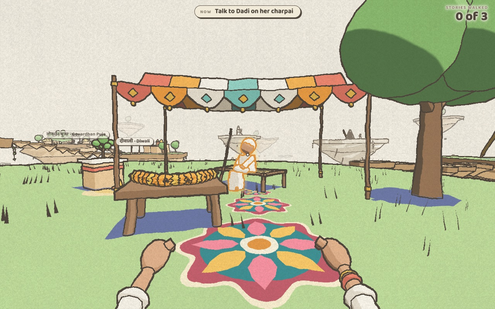
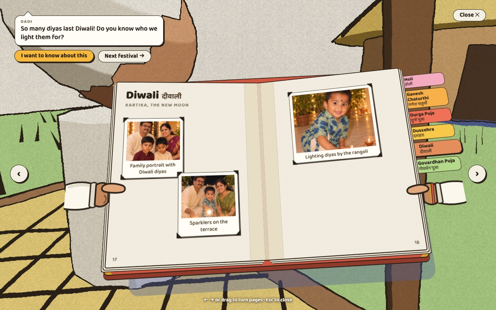
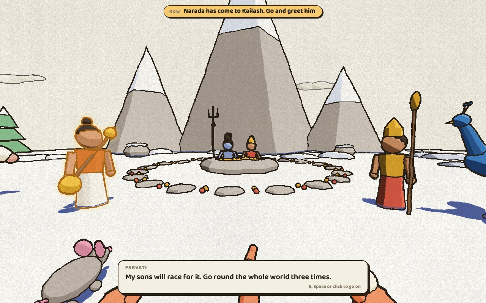
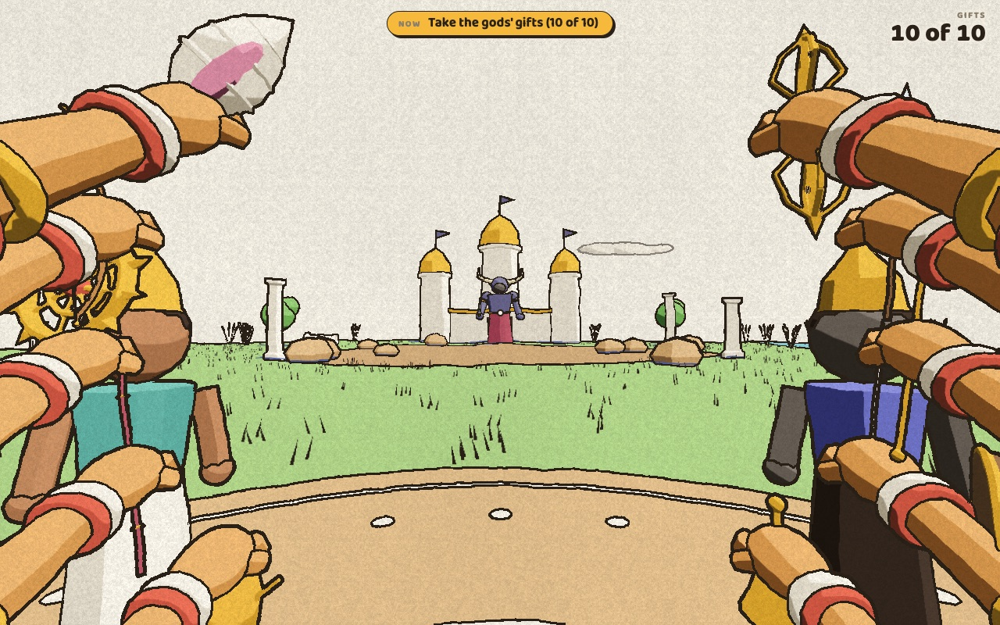
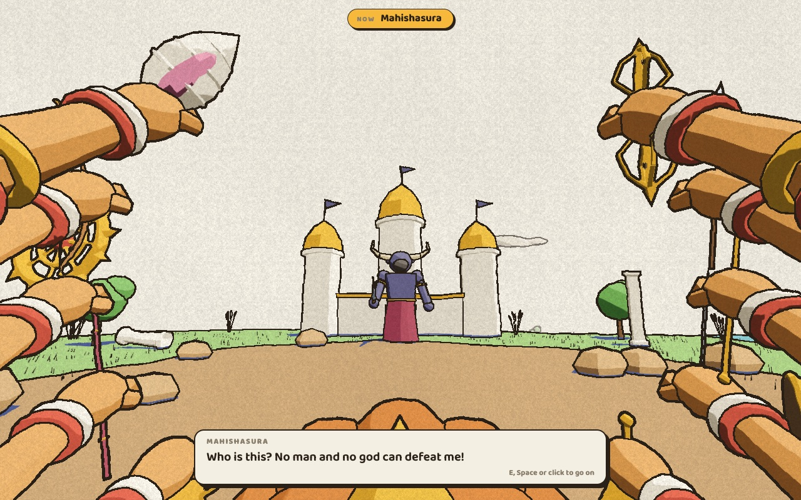
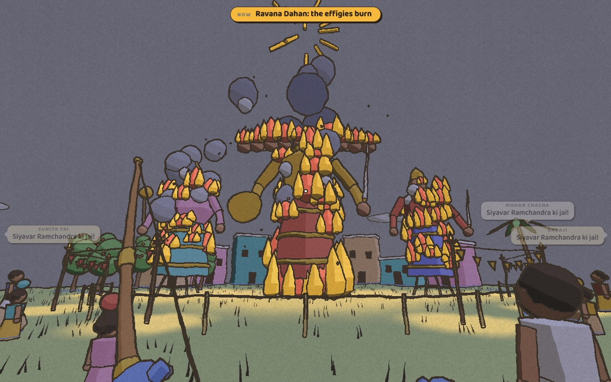
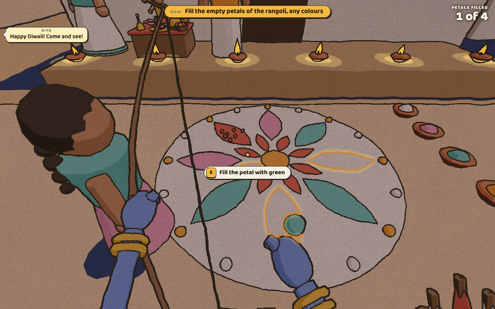

# Festive Islands

Floating paper islands in a ring, one festival each, in the order they come round the year. Walk the stepping stones, step through a torana, and become the hero of the story behind the festival: Prahlad for Holi, Ganesha for Ganesh Chaturthi, Durga for Durga Puja, Rama for Dussehra and Diwali, young Krishna for Govardhan Puja.

Built at Festive Hacks 2026 (WeMakeDevs × WeAreDevelopers, Bengaluru). Everything is drawn in one hand-inked, paper-and-ink look.

## Why we built this

Many Gen Z and millennials celebrate these festivals without knowing the stories behind them or why we do the rituals, and kids rarely get to hear them now. Here you play each story as its hero, then see how families celebrate it today. Made for kids first: no scores, no way to fail, and hints when you're stuck.


## Demo video

[](https://youtu.be/yT-BzQL_7Eo)

[Watch the demo on YouTube](https://youtu.be/yT-BzQL_7Eo)

## What we used

| Tool | What for |
|---|---|
| [Sarvam](https://www.sarvam.ai) | Character voices in English and Hindi |
| [Flagsmith](https://www.flagsmith.com) | Feature flags and an A/B test in Dadi's courtyard, plus the switch for the failure demo |
| [NudgeBee](https://nudgebee.com) | Events and alerting when a chapter fails to load |
| [three.js](https://threejs.org) | The 3D engine for every island |

### Sarvam: voices, generated once

Every main conversation on all six islands, and Dadi's welcome, is voiced with Sarvam's Bulbul v3 text-to-speech, in English and Hindi. Each character has their own Sarvam voice. The voices are not generated live: we run `scripts/generate-narration.ts` once, it saves every line as an MP3 in `audio/`, and the game plays those files. The player never waits on an API call, and no API key ships with the game. We regenerate only when a line of dialogue changes.

### Flagsmith: feature flags

| Flag | Type | Why we use it |
|---|---|---|
| `home_festival_canopy` | On/off | Adds a striped festive canopy over Dadi's charpai. We can dress the courtyard for a festival day without a deploy. |
| `home_rangoli_path` | On/off | Adds three rangoli patterns leading from the start to Dadi, to guide a new player to her. |
| `home_garland_cue` | `quiet` or `glow` | An A/B test: does a glowing garland with drifting petals get more players to pick it up? Flagsmith records `home_viewed`, `garland_picked_up` and `dadi_spoken_to` for each visit. |
| `govardhan_simulate_engine_failure` | On/off | Makes the Govardhan chapter fail to load on purpose, so we can demo the NudgeBee alert without breaking the real game. |

If Flagsmith is slow or a flag is missing, the player gets the default courtyard and the game carries on.

### NudgeBee: events and alerting

When the Govardhan chapter's 3D engine fails to load, the player sees a clear error card and the failure is sent to NudgeBee as an event, with the chapter, time and failed module. NudgeBee raises the alert and can run a workflow, for example running the chapter's self-test in a real browser to check whether the live game is really broken. A small local server, `demo/govardhan.mjs`, keeps the webhook URL out of the browser. Setup steps are in the NudgeBee section below.

## The islands

### Home · Dadi's aangan

Dadi sits on her charpai and tells you each island is a story. Then she opens her photo album: each festival has a few pages of the family's own photos, and from there she sends you to that island. Every island is open, and the stones glow toward the one she suggests.

| | |
|---|---|
|  |  |

### होली · Holi: Prahlad and Holika

You are the boy Prahlad. Pray to Vishnu in front of your father's throne, then sit calm in Holika's fire while the shawl flies off her. The night of Holika Dahan, walk once round the fire with new wheat; the next morning, throw gulal with the whole village.

| | | |
|---|---|---|
|  |  |  |

### गणेश चतुर्थी · Ganesh Chaturthi: the race round the world

You are Ganesha, with a trunk, a modak and Mushak at your side. Kartikeya flies off on his peacock; you work out that your parents are your world and walk three rounds round them. Then shape your own clay Ganesha, fold modaks with Aaji and join the aarti.

| | | |
|---|---|---|
|  |  |  |

### दुर्गा पूजा · Durga Puja: Durga and Mahishasura

You are Durga, with ten arms. Gather the gods' light, take their ten gifts, ride the lion and steady the trishul as Mahishasura changes shape. Then a Kolkata para at night: the dhak, the dhunuchi dance and pushpanjali.

| | | |
|---|---|---|
|  |  |  |

### दशहरा · Dussehra: Rama and Ravana

Build the setu stone by stone, cross to Lanka, draw the bow against the wind, then ride into the modern Ramlila and watch the effigies burn.

| | | |
|---|---|---|
|  |  |  |

### दीवाली · Diwali: Rama comes home

Land on Amavasya, wear the padukas Bharata kept, and walk home while Ayodhya lights about 770 lamps around you. Fill the rangoli, do the puja.

| | | |
|---|---|---|
|  |  |  |

### गोवर्धन पूजा · Govardhan Puja: the hill that became an umbrella

You are young Krishna. Persuade Vraj, lift Govardhan on your little finger and hold it steady through seven days of rain, then play the flute to bring everyone under it.

| | | |
|---|---|---|
|  |  |  |

### Colorfigures prototype

The same Govardhan story as an isometric step-through. This is where the design language comes from.


## Layout

```
index.html          the hub: home courtyard, six islands on a ring, gates
courtyard-flags.js  Flagsmith switches for the home courtyard
album/              Dadi's photo album (see album/README.md to add photos)
holi-prahlad/       Holi, first person
ganesh-race/        Ganesh Chaturthi, first person
durga-mahishasura/  Durga Puja, first person
dussehra-rama/      Dussehra, first person
diwali-ayodhya/     Diwali, first person
govardhan-fpv/      Govardhan Puja, first person (the engine the others copy)
colorfigures/       isometric SVG prototype
audio/              dialogue, narration manifests, playback
scripts/            narration generator (Sarvam)
demo/               local Govardhan server for the NudgeBee incident demo
tests/              audio tests
DESIGN.md           the visual language
hub-NOTES.md        hub mechanics, hash states, self-test
```

Each island folder has its own `NOTES.md` (mechanics, how it was built, facts to check) and `shots/`.

## Play

No build step. Three.js and Baloo 2 load from a CDN, so you need a network connection. Keep the folder structure intact, since the islands share the audio scripts and the album.

```bash
open -a "Google Chrome" index.html
```

Any island also opens on its own, for example:

```bash
open -a "Google Chrome" holi-prahlad/index.html
```

### Controls

| Key | Does |
|---|---|
| WASD or arrows | Walk |
| Mouse | Look (click to capture, or drag) |
| Space | Jump (holds instead when a Hold prompt shows) |
| Shift | Sprint |
| E | Talk, take, enter a gate |
| Hold mouse or Space | Draw the bow, lift the hill, stay calm, shape clay, steady the trishul |
| F or right-click | Flute (Govardhan), pray and pichkari (Holi) |
| Click, 1 to 5 | Throw gulal, change colour (Holi) |
| R | Replay the current voiced line |
| Esc or P | Pause: volume, narration language, wobble, progress |

## Sarvam · voices in English and Hindi

Every main conversation is voiced with Sarvam's Bulbul v3 text-to-speech, and each character has their own voice.

Begin plays a short Apple Music cue in the hub, Dussehra, Diwali, and Govardhan. The pause menu saves Voice, Music, and Effects levels across islands. Holi, Ganesh Chaturthi, and Durga Puja share the voice and effects controls. Narration language switches voiced dialogue and subtitles between English and हिन्दी.

Dialogue is authored in `audio/dialogue.js` and `audio/dialogue-hindi.js`. The main conversations in all six islands and Dadi's welcome have recorded voices. Voices and transition cues are configured in `scripts/generate-narration.ts`. If a clip is missing, the player still sees the authored text.

Generating narration needs Node 22.15+, FFmpeg on PATH and `SARVAM_API_KEY` in your environment. To regenerate specific lines, append their cue IDs after the language, for example `en-IN dadiIntro-5`.

```bash
node --experimental-strip-types scripts/generate-narration.ts en-IN
```

```bash
node --experimental-strip-types scripts/generate-narration.ts hi-IN
```

## Flagsmith · courtyard experiments

Dadi's courtyard is dressed by Flagsmith flags, so the team can change it and run an experiment without a deploy. `courtyard-flags.js` loads the Flagsmith SDK and identifies each player with a random ID kept in local storage.

| Flag | Type | What it does |
|---|---|---|
| `home_festival_canopy` | Boolean | A striped cloth canopy over Dadi's charpai |
| `home_rangoli_path` | Boolean | Three rangoli patterns leading from the spawn to Dadi |
| `home_garland_cue` | String, `quiet` or `glow` | The garland stool beside Dadi: at rest, or with a warm glow and drifting petals |

The garland flag is an A/B test: does a glowing garland get more players to pick it up? Entering the courtyard sends `home_viewed`, and the first interaction sends `garland_picked_up` or `dadi_spoken_to`, with the variant and both decoration switches attached. If Flagsmith is slow (over 2.5 s) or the flag is missing, the player sees the quiet garland and the visit is left out of the experiment. Reload the hub, or open `index.html#home`, to see a change. Setup for the warehouse and experiment is in [`hub-NOTES.md`](hub-NOTES.md).

## NudgeBee · loading incidents

If a chapter fails to load, the team should hear about it before a player does. The Govardhan chapter catches a failed 3D-engine load, shows the player a clear error card, and reports the failure to a NudgeBee webhook through a small local server (`demo/govardhan.mjs`). The server keeps the webhook URL secret, accepts reports only from its own page, and forwards one incident with the chapter, timestamp, simulation marker and failed module. A Flagsmith flag, `govardhan_simulate_engine_failure`, triggers the failure on demand for the demo.

### Record the NudgeBee loading incident

Use the deployed Govardhan chapter as the healthy comparison. For the recording, the local demo server serves the same chapter and reads its simulation flag from the Flagsmith environment you choose. A plain static copy skips the simulation. The courtyard flags keep their existing configuration.

1. In Flagsmith, create the Boolean flag `govardhan_simulate_engine_failure`, disabled by default. Enable it in your demo environment. The demo uses the existing public client key in `FLAGSMITH_API_KEY`. Set `FLAGSMITH_DEMO_ENVIRONMENT_KEY` only to select another environment.
2. For the event-only demo, set `NUDGEBEE_EVENT_WEBHOOK_URL` in `.env` to the generated Event Webhook URL. For a workflow demo instead, leave that variable unset. In NudgeBee, create an Automation Webhook, link it to a workflow's Webhook trigger, save and activate the workflow, and copy its generated URL into `NUDGEBEE_WEBHOOK_URL` in `.env`. The local server holds this secret. [Automation Webhook setup](https://docs.nudgebee.com/docs/integrations/Webhooks/automation_webhook/)
3. Run the server (Node 22+) from the repo root, then open [local Govardhan](http://127.0.0.1:4173/govardhan-fpv/). Every new page load reads the flag. When enabled, the browser requests a deliberately missing engine module, displays a persistent error, and sends one report automatically. When disabled or when Flagsmith is unreachable, the chapter loads normally.

   ```bash
   node --env-file=.env demo/govardhan.mjs
   ```

4. Record the playable deployed chapter, the local error, then the corresponding run in NudgeBee's history. The webhook payload includes the chapter, timestamp, simulation marker and failed module. A delivery acknowledgement in the game means the webhook accepted the report. Use the workflow history to see what ran.

For independent verification, configure a workflow step to run a WebGL-capable browser against the public deployed `govardhan-fpv/index.html#selftest` URL. Wait for the page title to become `SELFTEST PASS` or `SELFTEST FAIL` and pass the observed result to the summary step together with the webhook payload. Report a probe timeout as inconclusive. A successful HTTP fetch of the HTML alone cannot verify that the chapter rendered.

## Test

Audio tests:

```bash
node --experimental-strip-types --test tests/*.test.ts
```

Gameplay self-test: open the hub or any first-person island in Chrome and add `#selftest` to the end of the URL in the address bar. It plays the whole thing through and prints PASS or FAIL on the page and in the console.

Hash states like `#overview`, `#album=holi-prahlad`, `#fire` or `#dahan` jump straight to a beat. Each `NOTES.md` lists them.

## Credits

- The look is inspired by [Colorfigures](https://april-zhu.com/colorfigures) by April Zhu (MIT, Copyright (c) 2026 April Zhu), built on iso-glow (April Zhu) and iso-figure (Tolga Cohce). No Colorfigures code is copied; see each `NOTES.md`.
- [three.js](https://threejs.org) (MIT).

## AI tools

Built with Claude Code. The mythology and festival details are listed in each `NOTES.md` for a practising family to check.
