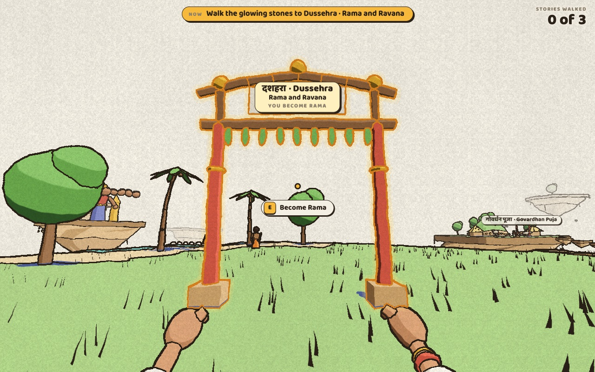
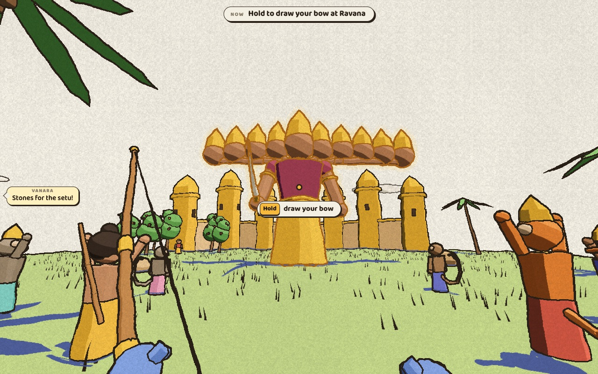
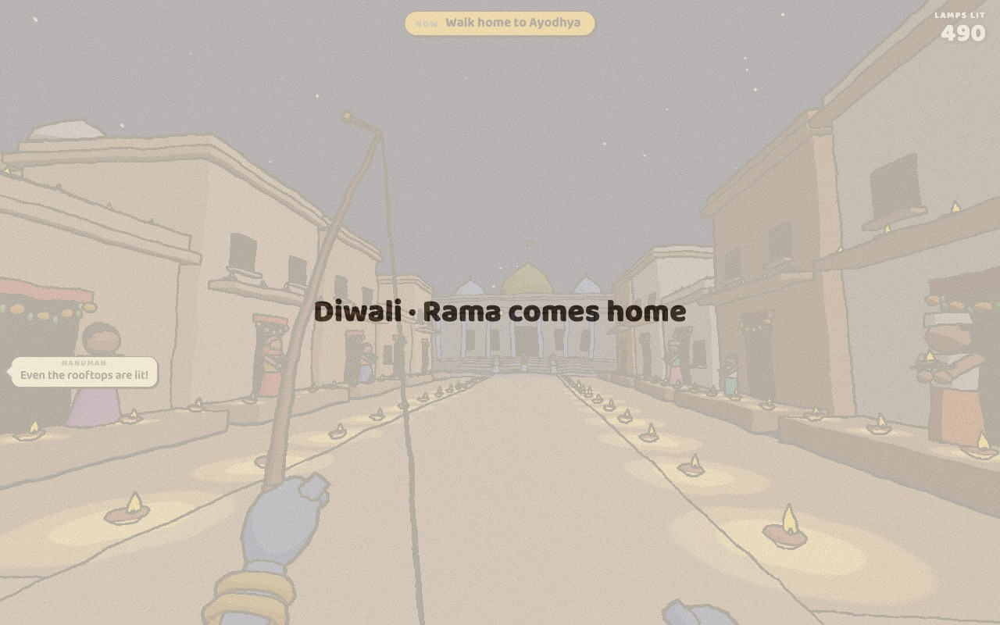
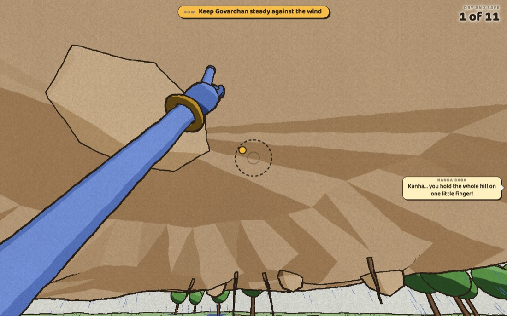
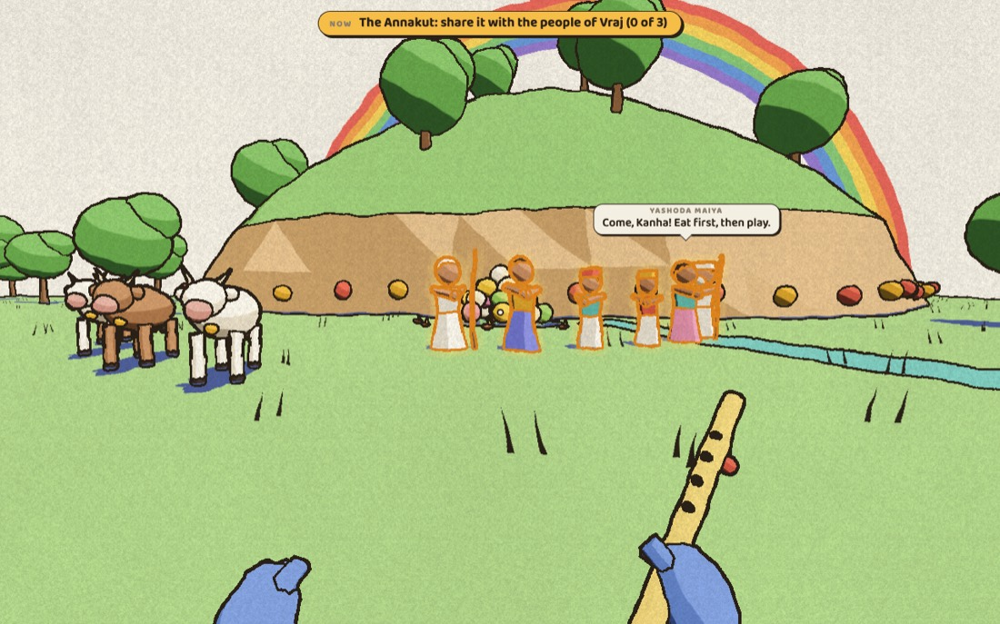

# Festive Islands

Floating paper islands, one festival each. Walk across the stepping stones, step through a torana, and become the hero of the story behind the festival: Rama at Lanka for Dussehra, Rama coming home for Diwali, young Krishna lifting Govardhan the day after.

Built at Festive Hacks 2026 (WeMakeDevs × WeAreDevelopers, Bengaluru). Everything is drawn in one hand-inked, paper-and-ink look.


## The islands

### Home · Dadi's aangan

Dadi sits on her charpai and tells you each island is a story. Every island is open. She suggests an order and the stones glow toward the next one.

| | |
|---|---|
|  |  |

### दशहरा · Dussehra: Rama and Ravana

Build the setu stone by stone, cross to Lanka, draw the bow against the wind, then ride into the modern Ramlila and watch the effigies burn.

| | | |
|---|---|---|
|  |  |  |

### दीवाली · Diwali: Rama comes home

Land on Amavasya, wear the padukas Bharata kept, and walk home while Ayodhya lights about 770 lamps around you. Fill the rangoli, do the puja.

| | | |
|---|---|---|
|  |  |  |

### गोवर्धन पूजा · Govardhan Puja: the hill that became an umbrella

You are young Krishna. Persuade Vraj, lift Govardhan on your little finger and hold it steady through seven days of rain, then play the flute to bring everyone under it.

| | | |
|---|---|---|
|  |  |  |

### Colorfigures prototype

The same Govardhan story as an isometric step-through. This is where the design language comes from.


## Layout

```
index.html          the hub: home courtyard, stepping stones, gates
courtyard-flags.js  Flagsmith switches for the home courtyard
dussehra-rama/      island 1, first person
diwali-ayodhya/     island 2, first person
govardhan-fpv/      island 3, first person (the engine the others copy)
colorfigures/       isometric SVG prototype
audio/              dialogue, narration manifests, playback
scripts/            narration generator (Sarvam)
tests/              audio tests
DESIGN.md           the visual language
hub-NOTES.md        hub mechanics, hash states, self-test
```

Each island folder has its own `NOTES.md` (mechanics, how it was built, facts to check) and `shots/`.

## Play

No build step. Three.js and Baloo 2 load from a CDN, so you need a network connection. Keep the folder structure intact, since the islands share the audio scripts.

```bash
open -a "Google Chrome" index.html
```

Any island also opens on its own, for example:

```bash
open -a "Google Chrome" govardhan-fpv/index.html
```

### Controls

| Key | Does |
|---|---|
| WASD or arrows | Walk |
| Mouse | Look (click to capture, or drag) |
| E | Talk, pick up, enter a gate |
| Hold mouse or Space | Draw the bow, lift the hill |
| F or right-click | Play the flute (Govardhan) |
| R | Replay the current voiced line |
| Esc or P | Pause: volume, narration language, wobble, progress |

## Audio and narration

Select Begin to hear a short Apple Music preview chosen for each island. Each story brings its cue back once at a transition. The pause menu saves separate Voice, Music and Effects levels across islands. Narration language switches voiced dialogue and subtitles between English and हिन्दी.

Dialogue is authored in `audio/dialogue.js` and `audio/dialogue-hindi.js`. Voices and transition cues are configured in `scripts/generate-narration.ts`. If a clip is missing, the player still sees the authored text.

Generating narration needs Node 22.15+, FFmpeg on PATH and `SARVAM_API_KEY` in your environment.

```bash
node --experimental-strip-types scripts/generate-narration.ts en-IN
```

```bash
node --experimental-strip-types scripts/generate-narration.ts hi-IN
```

## Test

Audio tests:

```bash
node --experimental-strip-types --test tests/*.test.ts
```

Gameplay self-test: open the hub or any first-person island in Chrome and add `#selftest` to the end of the URL in the address bar. It plays the whole thing through and prints PASS or FAIL on the page and in the console.

Hash states like `#overview`, `#gate=diwali-ayodhya` or `#dahan` jump straight to a beat. Each `NOTES.md` lists them.

## Credits

- The look is inspired by [Colorfigures](https://april-zhu.com/colorfigures) by April Zhu (MIT, Copyright (c) 2026 April Zhu), built on iso-glow (April Zhu) and iso-figure (Tolga Cohce). No Colorfigures code is copied; see each `NOTES.md`.
- [three.js](https://threejs.org) (MIT).

## AI tools

Built with Claude Code. The mythology and festival details are listed in each `NOTES.md` for a practising family to check.
